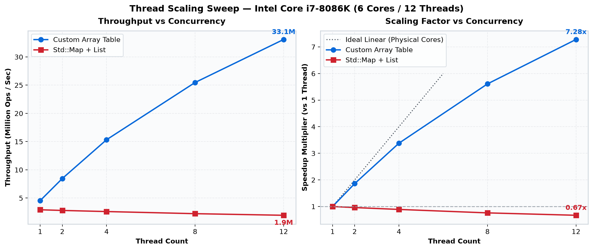

# High-Performance Array-Backed LRU Hash Table


Concurrent LRU Hash Table optimized for:
* multi-core scalability
* predictable tail latency
* NUMA architectures
* zero runtime allocations


## Table of Contents
1. [The Problem: The Standard Library Bottleneck](#the-problem-the-standard-library-bottleneck)
2. [The Solution: Core Architecture & Algorithms](#the-solution-core-architecture--algorithms)
3. [Benchmarks & Scaling Performance](#benchmarks--scaling-performance)
4. [When This Table May Not Be the Best Fit](#when-this-table-may-not-be-the-best-fit)
5. [Quick Start API Overview](#quick-start-api-overview)
6. [Project Structure](#project-structure)
7. [Building test code](#building-test-code)
8. [Conclusion & Future Hardware Extrapolation](#conclusion--future-hardware-extrapolation)
9. [License](#license)


A high-performance concurrent LRU hash table designed for demanding systems programming workloads such as caching layers, network infrastructure, and kernel components. By leveraging 
shard-based parallelism and cache-friendly memory layouts, the implementation delivers high throughput in environments where standard library containers degrade under contention.

### Key Architectural Highlights
* **Zero Runtime Allocations:** Pre-allocated flat arrays eliminate heap fragmentation and OS-level lock stalls.
* **Custom TTAS Spinlocks:** Replaces `std::shared_mutex` (used in standard library concurrent LRU baselines) to eliminate OS context switches and reader-to-writer lock upgrade hazards, achieving 14x+ throughput and sub-microsecond tail latencies. 
(Note: User-mode uses a custom TTAS Spinlock for raw speed, while Kernel-mode relies on `EX_PUSH_LOCK`).
* **Sharded Architecture:** Eliminates global lock convoys, scaling linearly with physical CPU core counts.
* **NUMA-Aware Memory:** Distributes shard allocations across physical CPU sockets to maximize memory controller bandwidth.
* **Lock-Free Destruction:** Payloads are explicitly destroyed outside the synchronization boundary, ensuring flat tail latencies.
* **Lazy LRU Promotion:** A tunable "Safe Zone" bypasses expensive LRU promotions (which require exclusive lock upgrades in traditional `std::shared_mutex` designs and dirty multiple cache lines) on hot reads, yielding an ~20% throughput boost.
* **Custom Allocators (User-Mode):** Supports template-injected allocators for domain-specific memory management with automatic cache-line alignment.
* **Dual Environment Ready:** Full cross-platform user-mode support (x86_64 and ARM64) alongside a dedicated Windows 10+ Kernel implementation (`IRQL < DISPATCH_LEVEL`).

The implementation prioritizes **mechanical sympathy, cache locality, lock scalability, and predictable memory behavior**, making it suitable for demanding environments such as:
* High-Frequency Trading (HFT) infrastructure
* Storage subsystem caches
* Real-time network routing
* Kernel / driver components
* High-throughput web servers

The implementation provides **O(1) average-time operations** for insertion, lookup, and removal while maintaining a strict or probabilistic **Least Recently Used (LRU)** eviction policy.

---

## The Problem: The Standard Library Bottleneck
Typical concurrent LRU implementations (such as the `std_lru_hash_table.h` baseline in the test suite, which combines `std::unordered_map` + `std::list` protected by `std::shared_mutex`) suffer from severe architectural flaws on 
modern high-core-count CPUs:

1. **Global Lock Contention & Upgrade Hazards:** A single `std::shared_mutex` creates a catastrophic "lock convoy," and promoting an item to MRU on a read requires dropping the shared read lock, acquiring an exclusive write lock, and re-verifying state against ABA hazards—where adding threads actually *decreases* total throughput.
2. **Pointer Chasing:** Node traversal across the heap destroys L1/L2 cache locality.
3. **Allocator Overhead:** Every insertion/eviction triggers heap allocation/deallocation (`new`/`delete`), resulting in memory fragmentation and OS-level lock stalls.
4. **False Sharing:** Unaligned memory structures cause adjacent CPU cores to invalidate each other's L1 cache lines, silently destroying performance.

---

## The Solution: Core Architecture & Algorithms
This project solves the standard library bottlenecks through a combination of sharding, flat-array memory management, and lock-free destruction techniques.

This diagram illustrates the architecture of an LRU hash table that eliminates global lock contention by partitioning data into independent, cache-aligned shards. 
Each shard operates autonomously with its own exclusive TTAS spinlock (or push lock in KM), metadata counters, and a contiguous "Mega-Block" of memory containing the bucket and node arrays. Within these 
arrays, both the hash collision chains and the doubly-linked LRU queues are constructed using 32-bit array indices rather than standard 64-bit pointers, which halves the structural 
memory overhead and improves L1/L2 cache locality during hot-path operations.

At a high level, the table is partitioned into independent shards, each managing its own hash table and LRU chain:

```text
=============================================================================
                      [ Master Hash Table Object ]                      
=============================================================================
      |
      +---> [ Shard Array ] (Contiguous aligned block, scaled to ~ CPU Cores * 32)
              |
              +--- [ Shard 0 ] (64/128-byte aligned to prevent false sharing)
              |      |
              |      +-- Synchronization : Exclusive TTAS Spinlock (UM) / EX_PUSH_LOCK (KM)
              |      |
              |      +-- Meta Counters   : ActiveCount, Capacity, Generation, ThresholdAge
              |      |
              |      +-- Chain Pointers  : LruHead, LruTail, FreeHead (32-bit indices)
              |      |
              |      |                     (Hash Collision Chain via HashNext)
              |      +-- Buckets Array   : [ Head_Idx ] [ INVALID ] [ Head_Idx ] ...
              |      |                           |                        |
              |      |                           v                        v
              |      +-- Nodes Array     : [ Node 0 ]                 [ Node 4 ]
              |          (The Mega-Block)  [ Node 1 ] <--- FreeHead       |
              |                            [ Node 2 ] <--- LruHead        v
              |                            [ Node 3 ]                 [ Node 5 ]
              |                            ...
              |                            [ Node N ] <--- LruTail (Next Eviction)
              |
              |     (Inside LruNode) --> +-----------------------------------+
              |                          | HOT PATH: Hash, HashNext, LruPrev |
              |                          | MATCH:    union { TKey Key; }     |
              |                          | COLD:     TValue*, LastPromoted,  |
              |                          |           LruNext                 |
              |                          +-----------------------------------+
              |
              +--- [ Shard 1 ] (Isolated locks & capacity bounds)
              |      |
              |      +-- Synchronization : ...
              |      +-- Buckets Array   : [ ... ]
              |      +-- Nodes Array     : [ ... ]
              |
              +--- [ Shard 2 ] 
              |
             ...
              |
              +--- [ Shard N ]
```

#### Node Memory Layout (Mechanical Sympathy)
To maximize L1/L2 cache hit rates, the internal node structure explicitly separates data based on access frequency during traversal:

The Hot Path (First Cache Line): Variables critical for navigating collision chains and verifying matches (`Hash`, `HashNext`, `LruPrev`, and `Key`) are tightly packed into the 
first hardware cache line (64 bytes or 128 bytes depending on architecture). This ensures that the CPU can scan deep hash buckets in a single memory fetch without triggering expensive main-memory stalls.

The Cold Path: Variables required only after a successful key match or during an eviction (`Value*`, `LastPromoted`, `LruNext`) are pushed off to secondary fields. This guarantees 
that the memory controller never wastes bandwidth fetching payload pointers or age metrics for nodes that are merely being passed over during a lookup scan.

```text
-------------------------------------------------
| Hash | HashNext | LruPrev | Key |              |
-------------------------------------------------
| Value* | LastPromoted | LruNext |              |
-------------------------------------------------
HOT PATH (cache line)     COLD PATH
```

### 1. Sharded Parallelism
The table is split into **independent, isolated shards**. Each shard contains its own hash buckets, LRU list, spinlock, and capacity limits. 
* Shard count is dynamically scaled based on processor topology (`shards ≈ CPU cores × 32`, capped at `4096`).
* Threads and internal buckets are routed using a hardware-accelerated 128-bit multiply-and-fold mixer (`MixHash`, wyhash-style MUM) using a 64-bit prime constant (`0x8bb84b93962eacc9ULL`). By leveraging native 64-bit multiplier instructions (`_umul128` on x64, `__umulh` on ARM64, and `unsigned __int128` on GCC/Clang), it collapses the mixing dependency chain down to just 2–3 instructions (multiply + XOR).
* This forces high-order entropy thoroughly across all bits, allowing disjoint bit ranges of the mixed hash to route both the shard and the intra-shard bucket independently without bit-overlap correlation: `shard = MixHash(hash) & (ShardCount - 1)` and `bucket = (MixHash(hash) >> 12) & BucketMask`.
* This prevents clustering on weak, aligned, or sequential keys, saves ~3–4 CPU cycles per lookup, and significantly cuts worst-case P99.99 tail latency spikes while avoiding global lock contention by design.

### 2. Array-Backed Mega-Blocks & 32-bit Indices
Instead of allocating nodes individually on the heap, all nodes and buckets are pre-allocated in **contiguous flat arrays** (Mega-Blocks). 
* **Zero Runtime Allocations:** Once initialized, the table never calls `new` or `delete` to allocate heap or pool memory.
* **Relative 32-bit Indices:** Linked lists (LRU chains and Hash collisions) are implemented using 32-bit array indices instead of 64-bit pointers. This cuts the structural memory overhead in half and dramatically increases the number of nodes that fit inside the CPU's L1/L2 cache.
* **NUMA Awareness:** The user-mode table utilizes `VirtualAllocExNuma` (Windows) or `libnuma` (Linux) and the kernel-mode table utilizes `ExAllocatePool3` to distribute shard allocations evenly across physical CPU sockets, maximizing memory controller bandwidth.

### 3. Mechanical Sympathy & Cache Management
Memory layout is strictly controlled to respect hardware-specific cache alignment. The User-Mode (UM) implementation dynamically adjusts alignment (64 bytes on x86_64/standard ARM64, and 128 bytes on Apple Silicon), while the Kernel-Mode (KM) implementation statically targets 64-byte alignment for standard Windows architectures (x64 and ARM64). Both the `Shard` array and per-shard Mega-Blocks are over-allocated and aligned to exact cache-line boundaries.

**False Sharing Prevention:**
```cpp
struct alignas(CACHE_LINE_SIZE) Shard { ... }; // 64 or 128 bytes in UM, strictly 64 in KM
```
Shards are explicitly padded to these hardware-specific cache line boundaries. A thread locking Shard A will never invalidate the cache line for a thread accessing Shard B.

**Hot/Cold Path Struct Packing & C++20 Lifetime Safety:**
```cpp
struct alignas(CACHE_LINE_SIZE) LruNode 
{
    // --- HOT PATH (First Cache Line) ---
    uint64_t Hash;         // Cached to avoid rehashing
    uint32_t HashNext;     // Hash collision chain index
    uint32_t LruPrev;      // LRU chain index
    union
    {
        TKey Key;          // Starts at 16-byte boundary
    };
    
    // --- COLD PATH ---
    TValue* Value;         // Accessed only on exact match
    uint64_t LastPromoted; // Age tracking
    uint32_t LruNext;      // LRU chain index
};
```

Variables required for hash traversal are packed into the first portion of the first cache line. The CPU fetches these together in a single read, guaranteeing a cache hit during deep collision chain probing, while `Lookup()`, `Add()`, and `Remove()` issue software prefetch hints (`CACHE_PREFETCH`) for the bucket head prior to lock acquisition. Wrapping `Key` in an unrestricted anonymous `union` ensures that pre-allocating `LruNode` arrays does not implicitly construct/destruct non-trivial `TKey` types prior to placement `new`.

### 4. Advanced Concurrency Controls
* **Out-of-Lock Destruction & Fast-Path In-Place Construction:** Deadlocks and latency spikes are avoided by guaranteeing that expensive user destruction code runs outside the synchronization boundary. Evicted nodes are detached, the lock is dropped, and only then is the payload destructed/released. During `Add()` when free nodes are available, trivially copyable keys (`std::is_trivially_copy_constructible_v<TKey>` in UM, `__is_trivially_copyable(TKey)` in KM) are constructed in-place within a single lock acquisition, while non-trivial keys drop the lock during copy construction.

* **Synchronous Enumeration Warning:** While destructors run lock-free, the `Enumerate() const` method executes user callbacks synchronously while holding an exclusive lock on the active shard (passing `const TKey&` to protect hash invariants). User callbacks MUST NOT attempt to modify the table to prevent recursive deadlocks.

* **Lazy LRU Promotion (Generation Counter):** Traditional concurrent LRUs based on `std::shared_mutex` promote items to the MRU head on every read, requiring an expensive shared-to-exclusive lock upgrade and ABA re-verification loop. Instead, this implementation acquires a microscopic exclusive shard lock and uses a probabilistic `Generation` counter. If a read hits a "hot" item whose age delta (`Generation - LastPromoted`) is within the threshold, the promotion is skipped—avoiding reader-writer upgrade hazards and avoiding dirtying the LRU list and neighbor node cache lines—allowing the thread to complete the read instantly.

* **Optional Proactive Trimming (Pipelined Execution):** The table is fully autonomous; when a shard reaches capacity, `Add()` automatically performs inline LRU eviction to make room. Therefore, a dedicated background trimming thread is not required for continuous operation. However, to guarantee ultra-flat P99/P99.9 tail latencies on your foreground hot path, you can optionally invoke `Trim()` during relatively idle cycles or from a low-priority background worker. Proactively trimming active items from shards exceeding the 90% high-watermark down to the 85% low-watermark ensures foreground insertions consistently hit warm, pre-allocated free nodes. To ensure `Trim()` never holds a shard lock for long, it detaches a single node at a time, drops the lock to destruct the key and release the value, executes a hardware pause (`CPU_PAUSE()` / `YieldProcessor()`) while unlocked so foreground threads win cache-line arbitration, and pipelines the cleaned node's return to `FreeHead` into the next iteration's lock acquisition (cutting lock acquisitions per evicted node in half).

### 5. Policy-Driven Spinlock (User Mode)
The Array-backed table replaces `std::shared_mutex` with a custom `SpinLock` designed specifically for microscopic critical sections. It attempts an immediate `exchange(true, acquire)` on the uncontended fast path and implements the TTAS pattern under contention to strictly prevent MESI protocol bus floods ("Cache Line Bouncing") on multi-socket / multi-core systems. On ARM64, where a standard `yield` instruction executes as a 1-cycle NOP on single-threaded cores, `CPU_PAUSE()` uses an Instruction Synchronization Barrier (`isb`) to pause the pipeline for ~15–30 cycles without bus traffic, preventing premature OS sleep storms.

**Supported Spin Policies:**
To accommodate different execution environments, the lock behavior is injected at compile-time:

* **AdaptiveSpinPolicy (Default):** Maximizes throughput by spinning for up to 4,000 hardware pauses in user-space, falling back to a forced OS deschedule (`SwitchToThread` on Windows, `sched_yield` on macOS, or a 500ns `nanosleep` on Linux) to prevent deadlocks and LHP stalls during severe contention.
* **ExponentialBackoffPolicy (Opt-in):** Implements a dynamic, self-tuning backoff strategy for high-contention environments. Instead of polling the lock at a constant rate, waiting threads double their hardware pause batches (`1, 2, 4, 8` up to `MAX_BACKOFF_PAUSES`) after every failed check up to 4,000 total pauses before yielding to the OS scheduler.

### 6. Adaptive Shard Scaling (Small Tables)
To avoid synchronization overhead on small data sets, the implementation automatically scales down active shards for smaller capacities. While the shard calculation algorithm targets ~64 items per shard to safely absorb statistical hash clustering, the table enforces an absolute physical minimum of 8 items per shard.

This ensures that small tables do not suffer unnecessary lock or memory fragmentation costs while still preserving the same API and behavior.

---								
## Benchmarks & Scaling Performance
To prove the architecture, the Custom Array Table was benchmarked against the standard library baseline implementation (`test_common/std_lru_hash_table.h`, which uses `std::unordered_map` + `std::list` protected by `std::shared_mutex`) across three distinct hardware topologies:

* Intel Core i7-1165G7 (4 Cores / 8 Threads, Low Power)
* Intel Core i7-8086K (6 Cores / 12 Threads, High Clock)
* Intel Core i7-12700H (14 Cores / 20 Threads, Big.LITTLE)

*Workload: 1,000,000 capacity, Mix of Add/Lookup/Remove/Trim, 0% Safe Zone. Multi-Threaded Scaling (The "Lock Convoy" Collapse)*

#### 1. Multi-Threaded Scaling (The "Lock Convoy" Collapse)
The Array-Backed table scales positively with physical hardware, whereas the standard library implementation exhibits negative scaling under heavy mixed contention.

| Implementation       | i7-1165G7 (Mobile, 8-Thread) | i7-8086K (Desktop, 12-Thread) | i7-12700H (Hybrid, 20-Thread) |
| :------------------- | :--------------------------- | :---------------------------- | :---------------------------- |
| **Std: Map+List**    | 0.70x (Negative Scaling)     | 0.67x (Negative Scaling)      | 0.49x (Negative Scaling)      |
| **Array-Table**      | **3.41x** (at 8 threads)     | **7.28x** (at 12 threads)     | **7.51x** (at 20 threads)     |

#### Thread Scaling Sweep graphs (Intel Core i7-8086K)


#### 2. Predictable Tail Latency (P99.9, P99.99)
At extreme percentiles, the Array-Backed table maintains low-microsecond latency, bypassing the severe latency spikes characteristic of standard OS-mediated locks (`std::shared_mutex`).

At the 99.9th percentile, we measure the worst-case algorithmic contention (e.g., deep hash collisions or lock upgrades in the `std::shared_mutex` baseline). The custom array maintains low-microsecond latency.

| Metric (P99.9 Latency)  | i7-1165G7 (Mobile)          | i7-8086K (Desktop)          | i7-12700H (Hybrid)         |
| :---------------------- | :-------------------------- | :-------------------------- | :------------------------- |
| **Std: Map+List**       | 1,039,800 ns                | 575,600 ns                  | 659,800  ns                |
| **Array-Table**         | **4,900 ns**                | **1,600 ns**                | **2,600 ns**               |
| **Stability Advantage** | **212x More Stable**        | **360x More Stable**        | **253x More Stable**       |

At the 99.99th percentile (P99.99), we observe the true cost of OS-mediated locking. 

| Metric (P99.99 Latency) | i7-1165G7 (Mobile)          | i7-8086K (Desktop)         | i7-12700H (Hybrid)         |
| :---------------------- | :-------------------------- | :------------------------- | :------------------------- |
| **Std: Map+List**       | 2,017,400 ns                | 983,100 ns                 | 1,078,800 ns               |
| **Array-Table**         | **12,000 ns**               | **6,400 ns**               | **20,600 ns**              |
| **Stability Advantage** | **168x More Stable**        | **153x More Stable**       | **52x More Stable**        |

*(Note: The jump to 20.6µs on the i7-12700H at P99.99 is the hardware signature of the OS Thread Director migrating a thread between a P-Core and an E-Core, forcing an L1/L2 cache flush).*

#### 3. Total Throughput Speedup (Mixed Contention)
Under heavy mixed workloads (simultaneous reads, writes, and evictions), the architectural differences create a compounding performance gap. As core counts increase, the standard table loses 
throughput due to contention, while the sharded Array-Backed table accelerates.

| System Profile                  | Array-Table Ops/Sec | Std Ops/Sec       | Total Speedup       |
| :------------------------------ | :------------------ | :---------------- | :------------------ |
| **Mobile (4-Core/8-Thread)**    | 26.7 Million        | 3.0 Million       | **~8.9x Faster**    |
| **Desktop (6-Core/12-Thread)**  | 53.0 Million        | 3.1 Million       | **~17.1x Faster**   |
| **Hybrid (14-Core/20-Thread)**  | 48.0 Million        | 2.3 Million       | **~20.9x Faster**   |

#### 4. The Impact of Lazy Promotion (Delayed LRU Updates)
Strict LRU caches based on reader-writer locks (`std::shared_mutex`) suffer under heavy read contention because every read requires an exclusive lock upgrade to update the LRU head, while even in exclusive-lock designs every promotion dirties multiple cache lines (`LruHead`, `LruTail`, and adjacent nodes' `LruPrev`/`LruNext` indices).

By utilizing a `Generation` counter, the cache probabilistically "ages" items. If an item is accessed but hasn't aged past the threshold, the promotion is skipped, allowing the 
thread to complete the read instantly without dirtying the node or LRU state cache lines. By using a microscopic exclusive lock without the overhead of reader-to-writer upgrade hazards, it achieves higher throughput than traditional
Reader-Writer lock (`std::shared_mutex`) implementations.

Workload: 95% Read / 5% Write on the 6-Core i7-8086K.

| Promotion Threshold | Behavior                  | Ops/Sec       | Performance Lift |
| :-------------------| :------------------------ | :------------ | :--------------- |
| **0% (Strict LRU)** | Promotes on every read    | 71.4 Million  | **Baseline**     | 
| **25% (Safe Zone)** | Promotes only older items | 79.6 Million  | **+ 11.5%**      | 
| **50% (Safe Zone)** | Promotes only stale items | 82.8 Million  | **+ 16.0%**      | 
| **100% (FIFO)**     | Never promotes on read    | 86.2 Million  | **+ 20.7%**      |


#### 5. Cloud & Virtualized Environments: Overcoming Lock Holder Preemption (LHP)
On Linux guests in virtualized environments (VMware, AWS, Azure), spinning vCPUs can trigger VM-Exit storms if the lock-holder is preempted by the hypervisor (LHP). Standard library locks (`std::shared_mutex` in `std_lru_hash_table.h`) suffer severely from this due to heavy OS context switching.

To combat this, the table relies on its custom spinlocks, which fall back to a 500-nanosecond `nanosleep` on Linux after 4,000 hardware pauses to force the hypervisor to schedule the preempted lock-holding vCPU. **Both available policies effectively mitigate LHP** compared to the standard library `std::shared_mutex` baseline, but their performance characteristics vary
significantly depending on the guest Linux distribution and its underlying CPU scheduler:

**Benchmark: Linux Guests on VMware (Windows 10 Host, 4 vCPUs)**

Testing across different distributions reveals that the optimal lock strategy is highly dependent on the guest OS:

* **Ubuntu:** The `ExponentialBackoffPolicy` offers slightly better P99.9 tail latency stability, trading peak scaling throughput for stricter latency bounds.
* **Fedora:** The `AdaptiveSpinPolicy` outperforms the exponential backoff approach across the board, delivering better P99.9 stability and P99.99 tail latency. 

**Recommendation for Cloud Deployments:**
Since hypervisor configurations and Linux CPU schedulers (CFS or EEVDF) react differently to constant-rate spinning versus exponential backoff, **do not blindly default to one policy on Linux**. 
It is highly recommended to profile both policies on your specific target OS and hypervisor combination to determine which yields the best tail latency for your workload.

**How to Toggle Policies (Linux Only):** Windows handles LHP natively, so this mitigation is strictly for Linux deployments. By default, the build uses `AdaptiveSpinPolicy`. You can opt into the exponential backoff 
lock using conditional compilation during the build step:

```bash
# Enable the ExponentialBackoffPolicy for virtualized Linux hardware (e.g., Ubuntu targets)
cmake .. -DUSE_EXPONENTIAL_BACKOFF=ON
```

#### 6. Reproducing Benchmarks
All benchmarks were produced on Windows 10/11 using the `test_um` suite included in this repository, compiled with Microsoft Visual Studio 2026 using `AdaptiveSpinPolicy` SpinLock wait policy.

---
## When This Table May Not Be the Best Fit
While this architecture excels under heavy concurrent workloads, it is not a silver bullet. In some scenarios, a standard library composition (such as `std::unordered_map` + `std::list`) may be the more appropriate choice:

* **Massive Datasets (>= 4 Billion Items per Shard):** To maximize cache locality, the table utilizes 32-bit array indices instead of 64-bit pointers for its linked lists, reserving `0xFFFFFFFF` (`INVALID_INDEX`) as the list-termination sentinel. Consequently, a single shard cannot physically address more than `UINT32_MAX - 1` items. If your dataset exceeds this capacity per shard, initialization will safely abort.
* **Extremely Small Tables (< ~100 items):** While the table internally reduces shard counts when capacity is small (enforcing at least 64 items per shard and collapsing to a single shard below **128 entries**), the baseline overhead of hardware hash mixing (`MixHash`), atomic reference counting, and shard routing can dominate on microscopic datasets. In these cases, a simple STL-based LRU protected by a `std::mutex` is often faster.
* **Strictly Single-Threaded Workloads:** This table is explicitly designed to solve multi-threaded locking bottlenecks. In purely single-threaded environments, a standard STL-based LRU may outperform it. The standard containers are highly optimized for uncontended execution, whereas the Array-Backed table still incurs the fixed overhead of atomic operations, memory barriers, and spinlock/pushlock acquisitions.
* **Highly Memory-Constrained Environments:** To achieve zero OS-heap allocations and prevent lock stalls, this table pre-allocates flat "Mega-Blocks" for its entire maximum capacity upfront. (Note: Runtime placement `new` is still executed within these blocks to construct keys). If your environment cannot afford to pre-allocate the maximum potential memory footprint, you must use a traditional node-based container that allocates memory on demand.

---
## Quick Start API Overview
Values must inherit or implement an intrusive, thread-safe reference counting interface (`AddRef()` and `Release()` must be declared `noexcept`, with `Release()` using acquire/release atomic barriers). Copy construction of the table is disabled (`= delete`), while move semantics are supported.

```cpp
// 1. Initialization
using CustomTable = LruHashTable<uint64_t, RefCountedPayload, MyHasher>;
CustomTable table;

// Initialize with capacity 1M, and a 25% LRU Promotion Safe-Zone
table.Initialize(1000000, 25); 

// 2. Proactive Trimming (Optional optimization to maintain flat tail latency)
// Can be executed during idle periods or scheduled via a lightweight background worker.
std::jthread trimThread([&table](std::stop_token stoken) 
{
    while (!stoken.stop_requested()) 
    {
        // Evicts up to 5000 LRU items, but ONLY from shards 
        // exceeding the 90% high-watermark, stopping at 85%.
        table.Trim(5000); 
        std::this_thread::sleep_for(std::chrono::milliseconds(350));
    }
});

// 3. Insertion
RefCountedPayload* payload = new RefCountedPayload(data);
payload->AddRef();
table.Add(key, payload);
payload->Release(); // Safely drop local reference

// 4. Lookup
RefCountedPayload* out = nullptr;
if (table.Lookup(key, out)) 
{
    // Use the payload...
    out->Release(); // MUST release when done
}

// 5. Removal
table.Remove(key);

```

---
## Project Structure
The repository is organized into distinct layers to separate the core hash table logic from the environment-specific wrappers and test suites:

* **`km/`**: Contains the **Kernel-Mode** LRU Hash table implementation.
    * `LRUHashTable.h`: The primary header for use in Windows Driver environments (x64 and ARM64).
	
* **`um/`**: Contains the **User-Mode** LRU Hash table implementation.
    * `lru_hash_table.h`: The cross-platform header for Linux, macOS, and Windows applications (x86_64 and ARM64).
    * `lru_string_key.h`: High-performance string-based key implementation.
	
* **`test_common/`**: Shared test logic used by both kernel and user-mode performance tests.
    * `std_lru_hash_table.h`: A standard library wrapper (`std::unordered_map` + `std::list` + `std::shared_mutex`) used as the baseline for benchmark comparisons.
    * `test_lru_hash_common.h`: Shared performance tests and validation logic.
	
* **`test_km/`**: Test code for verifying kernel-mode logic within a user-mode performance test harness.
    * `TestLRUHashKm.cpp`: The driver-logic test harness, strictly requiring MSVC 2026 on Windows.
	
* **`test_um/`**: Cross-platform user-mode performance test suite.
    * `test_lru_hash.cpp`: The primary benchmark and validation tool used on Linux, macOS, and Windows.
	
* **`test_drv/`**: Actual Windows Kernel driver performance test code for deployment on target systems.
    * `TestLruDrv.cpp`: Windows Kernel driver performance test code.

* **`sample_um/`** : User-mode sample code.
    * `sample_lru_hash.cpp`: User-mode C++ sample showing how to use efficient string-based key with LRU Hash table.

---
## Building test code
### Linux / macOS
Requires a C++20 compliant compiler (GCC or Clang).

*Linux Dependencies:*
The Linux user-mode implementation utilizes `libnuma` to bind shard allocations to physical CPU sockets, mimicking the memory controller routing of
the Windows kernel implementation. You must install the NUMA development headers before building:

```bash
# Ubuntu / Debian
sudo apt-get update
sudo apt-get install libnuma-dev numactl

# RHEL / Fedora / CentOS
sudo dnf install numactl-devel
```

*Using the Build Script (Recommended)*

`./build.sh [--clean | -c] [--hybrid] [--type Release | Debug] [--compiler g++ | clang++]`

```markdown
Defaults:
 - Build type: Release
 - Compiler: g++
 - Hybrid mode: OFF
 - Reuses existing build/

Options:
-c, --clean → Remove build/ before building
--hybrid    → Enables LRU_USE_EXPONENTIAL_BACKOFF to better mitigate Lock Holder Preemption (LHP) on virtualized hardware. If building on Linux, this will also link jemalloc if installed.
-t, --type  → Set build type (Release or Debug)
--compiler  → Choose compiler (g++ or clang++)
-h, --help  → Show help and exit
```
```bash

# Set permissions (once):
chmod +x ./build.sh

# Standard Release build using default C++ compiler
./build.sh

# Clean Release build using clang++ (Optimized for macOS or specific Linux tests)
./build.sh --clean --type Release --compiler clang++

# Debug build for troubleshooting
./build.sh --clean --type Debug
```

*Using CMake*
The included `CMakeLists.txt` automatically detects your platform, handles `libnuma` linking on Linux, and configures optimized build flags.

```bash
mkdir build && cd build
# Using -DUSE_EXPONENTIAL_BACKOFF=ON for virtualized environments (VMware/AWS/Azure)
cmake .. -DCMAKE_BUILD_TYPE=Release
cmake --build . -j $(nproc)
```

*Manual Compilation*
If you prefer building without CMake, ensure you include the `-pthread` and `-lnuma` (Linux only) flags for proper linking.

```bash
# GCC (Linux)
g++ -std=c++20 -O3 -march=native -flto=auto -funroll-loops -fomit-frame-pointer -fno-rtti -fexceptions -pthread \
    -I./um -I./test_um -I./test_common test_um/test_lru_hash.cpp -o bin/test_lru_hash -lnuma
	
# Clang (Linux/macOS - omit -lnuma on Mac)
clang++ -std=c++20 -O3 -march=native -flto -funroll-loops -fomit-frame-pointer -fno-rtti -fexceptions -pthread \
    -I./um -I./test_um -I./test_common test_um/test_lru_hash.cpp -o bin/test_lru_hash -lnuma

# Use -DUSE_EXPONENTIAL_BACKOFF=ON for virtualized environments (VMware/AWS/Azure)
```

**Optimizing for Linux Guest VMs:**
Cross-platform thread scaling inside virtual machines often hits bottlenecks due to guest OS scheduler behavior and standard library allocator contention. This implementation
addresses these bottlenecks and improves multi-threaded scaling through two specific mitigations:

* **Hard vCPU Yielding:** Standard `sched_yield()` (via `std::this_thread::yield()`) is frequently treated as a no-op by the Linux CFS scheduler when no other threads are waiting on that 
specific vCPU. This causes "busy-spins" that trigger VM-Exit storms. The spinlock policies mitigate this on Linux by forcing a hard context switch via a 500-nanosecond `nanosleep` 
once the 4,000-pause threshold is met, while `ExponentialBackoffPolicy` additionally batches hardware pauses (`1, 2, 4, 8`) to desynchronize polling threads.

* **Allocator Contention (`jemalloc`):** The default `glibc` `malloc` heavily throttles concurrent allocations in the benchmark suite. To prevent allocator bottlenecks on Linux, it is highly recommended to link 
against `jemalloc`. This replaces the contention-heavy system heap with a sharded, lock-free allocation strategy that complements the table's internal sharding.
```bash
# Install jemalloc (Ubuntu / Debian)
sudo apt-get install libjemalloc-dev

# Install jemalloc on RHEL / Fedora / CentOS
sudo dnf install jemalloc-devel
```

**Recommended Step:** Running the Benchmark on Linux
To ensure the test suite can accurately benchmark tail latencies, apply NUMA node affinity, and manage thread priorities without requiring full root privileges, it is highly recommended 
to grant the `test_lru_hash` executable the `CAP_SYS_NICE` capability before execution.
```bash
# Ubuntu / Debian
sudo apt install libcap2-bin 

# RHEL / Fedora / CentOS
sudo dnf install libcap          

sudo setcap cap_sys_nice+ep ./build/bin/test_lru_hash
```
### Windows (User-Mode & Kernel-Mode)
Native Visual Studio Solution (`.slnx`) and Project (`.vcxproj`) files are included in the repository.

**User-Mode:** Build using Visual Studio 2026 (or Visual Studio 2022 with the `v143` Platform Toolset).
* Requires C++20 (supports x64 and ARM64).
* NUMA support is handled natively via `VirtualAllocExNuma`.

**Kernel-Mode:** Build using Visual Studio 2026 and the Windows Driver Kit (WDK 11).
* Requires C++20 (supports x64 and ARM64).
* The implementation utilizes `EX_PUSH_LOCK` and performs 64-byte aligned, NUMA-aware Non-Paged Pool allocations via `ExAllocatePool3`.
* **IRQL Restriction:** Since the synchronization boundary uses push locks (which operate at `<= APC_LEVEL`), the current kernel implementation **can only be used at `IRQL < DISPATCH_LEVEL`** (i.e., `PASSIVE_LEVEL` or `APC_LEVEL`). Under extreme contention when all shard nodes are simultaneously in-flight, backoff automatically adapts to the current IRQL (`KeDelayExecutionThread` at `PASSIVE_LEVEL`, `YieldProcessor()` at `APC_LEVEL`). It is not safe for use inside DPC routines or hardware interrupt handlers.

---
## Conclusion & Future Hardware Extrapolation
Per Amdahl's Law, standard global-lock LRU implementations (such as `std::unordered_map` + `std::list` + `std::shared_mutex`) are heavily limited by their sequential synchronization overhead, inevitably leading to lock convoys under heavy contention. By 
utilizing a sharded architecture to isolate synchronization, the Array-Backed table minimizes that sequential fraction, allowing throughput to scale positively with parallel load.

Based on this mechanical sympathy, the performance advantage of this architecture will become even more pronounced on modern hardware topologies:

* **Massive L3 Caches (e.g., AMD 3D V-Cache / Server CPUs):** Utilizing 32-bit array indices halves the structural memory footprint. This allows significantly larger working sets to reside 
within L3 SRAM, deferring main-memory latency penalties.

* **High Parallelism & NUMA (Threadripper / EPYC / Xeon / Graviton):** Disjoint 128-bit multiply-and-fold mixing (`MixHash`) and NUMA-aware physical memory allocation evenly disperse workloads across physical sockets and intra-shard buckets. This sustains near-linear scaling well past the threshold where standard implementations degrade.

* **Symmetric Core Scaling & Cache Coherency (Ryzen / Threadripper / ARM64):** At extreme core counts, the "Lazy Promotion" optimization bypasses the exclusive lock upgrades required by reader-writer lock designs (`std::shared_mutex`) and skips LRU linked-list mutations on hot reads. This keeps targeted 
`Buckets` and `LruNode` cache lines clean in the Shared (S) state within the MESI protocol, allowing multiple cores across different chiplets to cache the same nodes locally without triggering cross-die write-invalidation traffic.

---
## License 
This project is licensed under the Apache License, Version 2.0. 

You may not use this file except in compliance with the License. You may obtain a copy of the License at:
[http://www.apache.org/licenses/LICENSE-2.0](http://www.apache.org/licenses/LICENSE-2.0)

Unless required by applicable law or agreed to in writing, software distributed under the License is distributed on an "AS IS" BASIS, WITHOUT WARRANTIES OR CONDITIONS OF ANY KIND, 
either express or implied. See the `LICENSE` file for the specific language governing permissions and limitations.